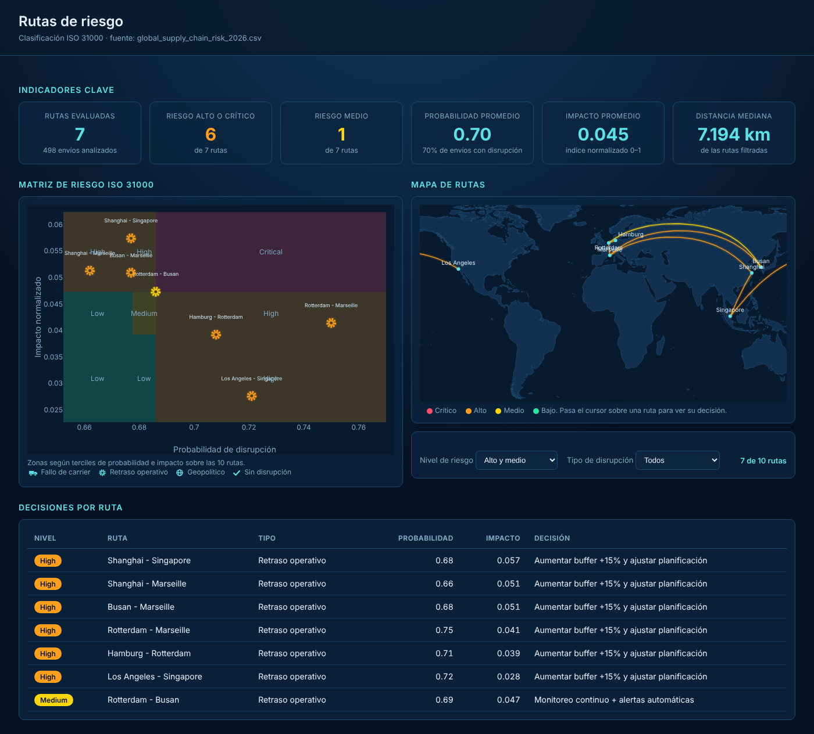

# Riesgo y disrupción en cadenas de suministro — Prototipo de portafolio

Prototipo de análisis de riesgo para una red logística internacional, con una metodología inspirada en **ISO 31000:2018**. A partir de 5.000 envíos (2024–2025) el proyecto construye:

1. Un **índice de impacto compuesto** con variables operativas, geopolíticas, de transportista y climáticas.
2. Una **matriz de riesgo por ruta** (probabilidad × impacto) con niveles Critical / High / Medium / Low y acciones asociadas.
3. Un **dashboard interactivo en HTML** con KPIs, filtros, matriz de riesgo, mapa mundial y tabla de decisiones.

> Proyecto de portafolio. Los resultados ilustran el método y no deben interpretarse como un diagnóstico de una red logística real.

---

## Estructura del repositorio

```
supply-chain-risk-analysis-iso31000/
├── Proyecto_logistica_Portafolio.ipynb   # Análisis completo (EDA, riesgo, matriz, dashboard)
├── global_supply_chain_risk_2026.csv     # Dataset de envíos
├── land.json                             # Geometría de tierra para el mapa mundial
├── index.html                            # Dashboard interactivo (se genera desde el notebook)
├── img/                                  # Capturas del dashboard
└── README.md
```

---

## Dataset

`global_supply_chain_risk_2026.csv`: 5.000 registros de envíos entre 2024-01-01 y 2025-12-31.

| Variable | Descripción |
|---|---|
| `Shipment_ID` | Identificador del envío |
| `Date` | Fecha del envío |
| `Origin_Port` / `Destination_Port` | Puerto de origen y destino (8 y 9 valores) |
| `Transport_Mode` | Modo de transporte: air, sea, road, rail |
| `Product_Category` | Categoría de producto (5 valores) |
| `Distance_km` | Distancia de la ruta (km) |
| `Weight_MT` | Peso del envío (toneladas métricas) |
| `Fuel_Price_Index` | Índice del precio del combustible |
| `Geopolitical_Risk_Score` | Score de riesgo geopolítico |
| `Weather_Condition` | Condición climática: clear, fog, rain, storm, hurricane |
| `Carrier_Reliability_Score` | Fiabilidad del transportista (0 a 1) |
| `Lead_Time_Days` | Tiempo de entrega en días |
| `Disruption_Occurred` | Indicador de disrupción (0 = no, 1 = sí) |

**Calidad de datos:** sin valores nulos, sin duplicados. Las columnas categóricas se normalizaron (sin espacios y en minúsculas) y se convirtieron a tipo `category`.

---

## Metodología

### 1. Auditoría y limpieza
- Revisión de nulos, duplicados, tipos de dato y categorías únicas.
- **Outliers (método de Tukey / IQR):** se mantienen. En `lead_time_days` hay 518 valores atípicos; se interpretan como retrasos reales (disrupciones), no como errores de medición.

### 2. Codificación y normalización
- **Clima (escala ordinal de severidad):** `clear` = 0, `fog` = 1, `rain` = 2, `storm` = 3, `hurricane` = 4.
- **Normalización min-max** a [0, 1] de `lead_time`, `geopolitical_risk`, `carrier` y clima.
- **Fiabilidad del transportista invertida** (`1 − min-max`): 0 es el escenario óptimo y 1 el riesgo máximo en todas las variables.

### 3. Índice de impacto compuesto (EDA)

```
impact = 0.4 · lead_time_norm + 0.3 · geo_norm + 0.2 · carrier_norm + 0.1 · weather_norm
```

Los pesos combinan juicio experto con la práctica de indicadores compuestos de la OECD (2008). El lead time pesa más porque afecta directamente el nivel de servicio y los costos de almacenamiento.

### 4. Tipo de disrupción
Cada envío se clasifica según el factor que más se desvía de su umbral crítico:
- Riesgo geopolítico > P90
- Fallo de transportista (fiabilidad < P10)
- Retraso operativo (lead time > P90)

Si ningún factor supera su umbral, el envío queda como `no_disruption`.

### 5. Matriz de riesgo por ruta (ISO 31000)
- Se evalúan las **10 rutas** con mayor tasa de disrupción.
- **Probabilidad** de la ruta = proporción de envíos con `Disruption_Occurred = 1` en esa ruta.
- **Impacto operativo** de la ruta = días de retraso × distancia × peso, donde el retraso es `max(lead_time − mediana, 0)`, normalizado entre rutas.
- Los niveles de probabilidad e impacto se calculan con **terciles sobre las 10 rutas** (promedio por ruta), para que la matriz, la tabla y el mapa usen los mismos niveles.

| Nivel | Criterio | Acción |
|---|---|---|
| 🔴 Critical | Alto impacto + alta probabilidad | Mitigación inmediata |
| 🟠 High | Alto en una dimensión | Plan de contingencia |
| 🟡 Medium | Medio en ambas | Monitoreo |
| 🟢 Low | Bajo en ambas | Aceptar y revisar periódicamente |

---

## Resultados principales

- **Ninguna de las 10 rutas alcanza el nivel Critical.**
- Las probabilidades de disrupción de las 10 rutas están entre 0,66 y 0,75: la exposición al riesgo es generalizada en la red.
- **Nivel High (6 rutas):**

  | Ruta | Probabilidad | Impacto normalizado |
  |---|---|---|
  | Shanghái – Singapur | 0,68 | 0,057 |
  | Shanghái – Marsella | 0,66 | 0,051 |
  | Busan – Marsella | 0,68 | 0,051 |
  | Rotterdam – Marsella | 0,75 | 0,041 |
  | Hamburgo – Rotterdam | 0,71 | 0,039 |
  | Los Ángeles – Singapur | 0,72 | 0,028 |

- **Nivel Medium (1 ruta):** Rotterdam – Busan (probabilidad 0,69; impacto 0,047).
- **Nivel Low (3 rutas):** Busan – Shanghái, Singapur – Amberes y Hamburgo – Los Ángeles.
- Por tipo de disrupción, los **retrasos operativos** tienen el mayor impacto medio (0,52), seguidos de los geopolíticos (0,44), los fallos de transportista (0,39) y los envíos sin disrupción (0,29).
- El **lead time** es el predictor con mayor peso en el índice; su correlación con el impacto es de 0,50 (Pearson). El riesgo geopolítico tiene la correlación más alta con el impacto (0,68).
- Los tres predictores del índice están prácticamente no correlacionados entre sí (|r| ≤ 0,09), por lo que aportan información distinta y no duplican factores.

---

## Dashboard interactivo

`index.html` es un archivo autocontenido que se abre directamente en el navegador. Incluye:

- KPIs generales de la red
- Filtros que recalculan todo en el navegador
- Matriz de riesgo ISO 31000
- Mapa mundial con las rutas analizadas
- Tabla de decisiones por ruta

Se genera con la última celda del notebook.

> **Nota sobre el desarrollo:** el dashboard se creó con apoyo de IA (Claude), a partir de un prompt que describe los datos, la matriz de riesgo y los filtros esperados. La lógica de clasificación y los resultados se revisaron y se ejecutaron en el notebook.



---

## Cómo ejecutar

```bash
# Dependencias de Python
pip install pandas numpy plotly seaborn matplotlib

# Geometría del mapa (genera land.json)
npm install world-atlas topojson-client
node make_land.js

# Abrir el notebook y ejecutar todas las celdas
jupyter notebook Proyecto_logistica_Portafolio.ipynb
```

El notebook espera `global_supply_chain_risk_2026.csv` y `land.json` en la misma carpeta. Al ejecutar la última celda se genera `index.html`.

---

## Limitaciones

- **Pesos del índice por juicio experto.** Falta un análisis de sensibilidad que valide la robustez de 0,4 / 0,3 / 0,2 / 0,1.
- **Muestras pequeñas por ruta.** Con unos 70 envíos por combinación origen–destino, las probabilidades tienen mucha incertidumbre.
- **Probabilidad como frecuencia histórica.** No hay un modelo predictivo: el análisis describe lo ocurrido, no pronostica lo que ocurrirá.
- **Clasificación por terciles.** Con solo 10 rutas, un cambio pequeño en los datos puede mover una ruta de nivel.

---

## Próximos pasos (Fase 2)

- Regresión logística para estimar la probabilidad de disrupción a partir de las variables operativas.
- Random Forest para capturar interacciones no lineales entre factores.
- Simulación Monte Carlo para cuantificar la distribución de pérdidas por ruta.
- Análisis de sensibilidad de los pesos del índice.
